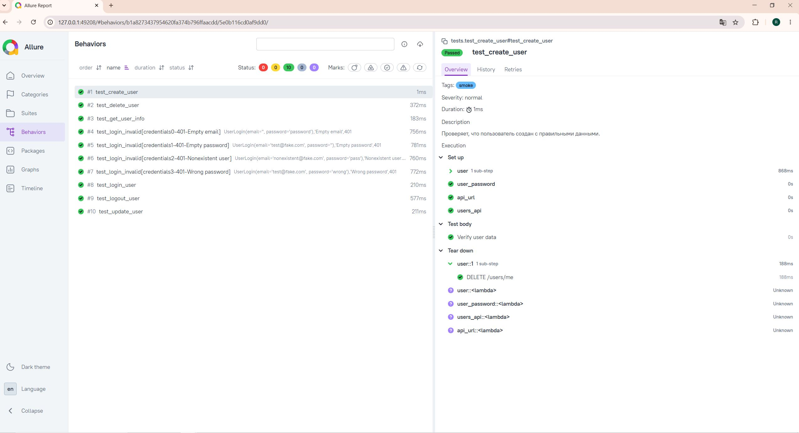
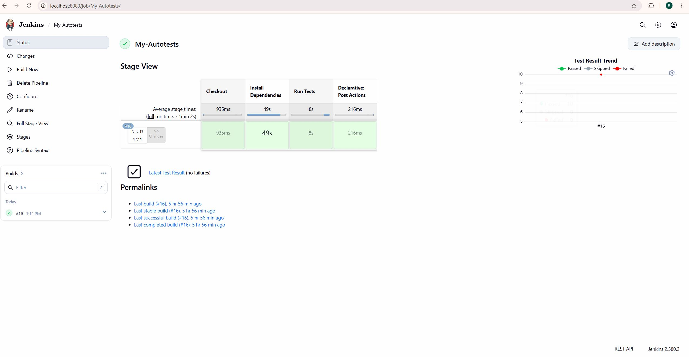
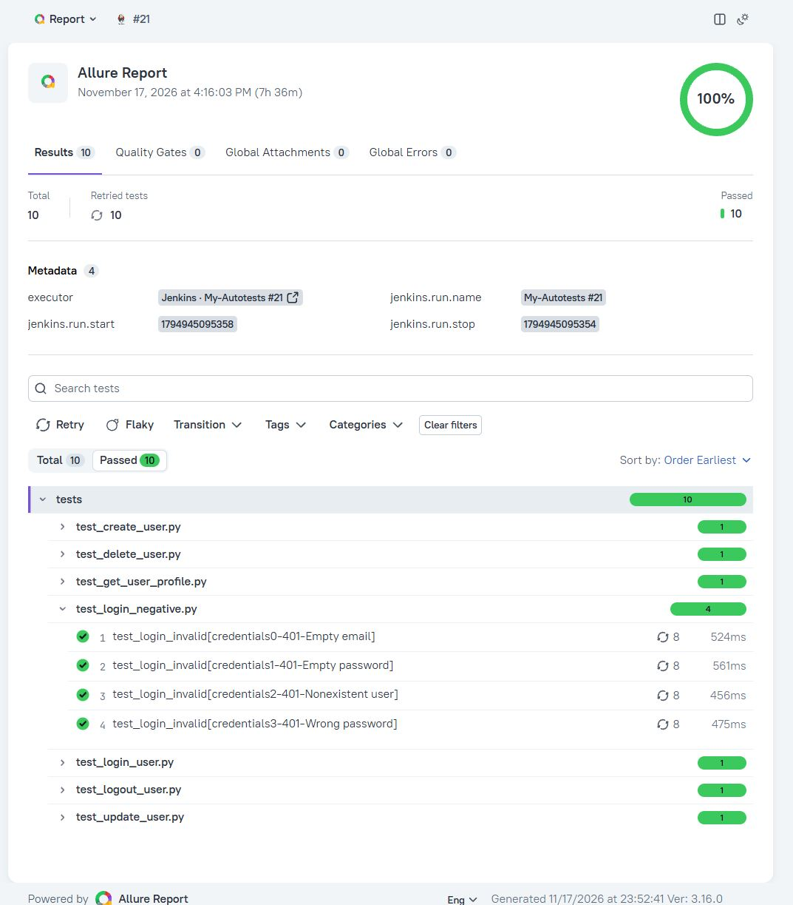

# API Testing Framework for Contact List App

**English** | [Русский](./README.ru.md)

[](https://www.python.org/)
[](https://pytest.org/)
[](https://allurereport.org/)


## 📖 API Documentation

- [Postman Collection — Contact List App](https://documenter.getpostman.com/view/4012288/TzK2bEa8)

## ✅ Test Coverage

- Create user
- Get user info
- Delete user

## 🛠 Tech Stack

| Technology | Purpose |
| :--- | :--- |
| **Python 3.14** | Programming language |
| **pytest** | Testing framework |
| **requests** | HTTP client for API calls |
| **Allure** | Test reporting |

## 🚀 Installation and Running

### 💻 1. Clone the repository

```bash
git clone https://github.com/zhrv80-prog/PythonProject.git
cd Portfolio_project_tests
```
## Allure



## Jenkins
The project is integrated with Jenkins. The pipeline automatically runs tests when changes are pushed to the repository. The pipeline configuration is stored in the Jenkinsfile.



## Allure report in Jenkins

