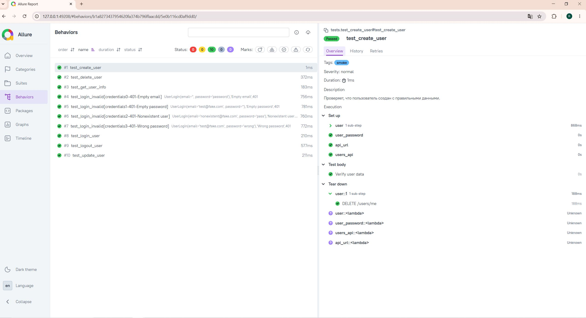
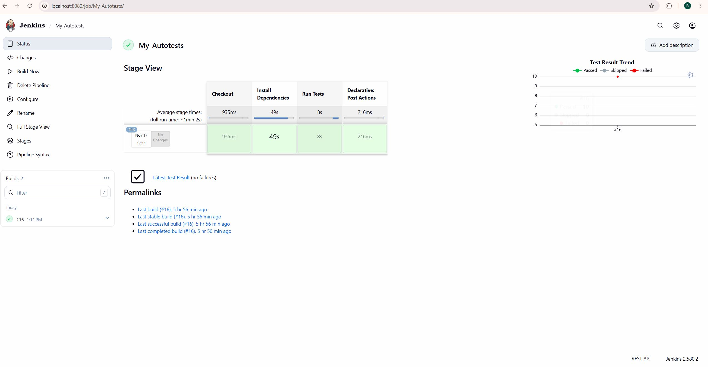
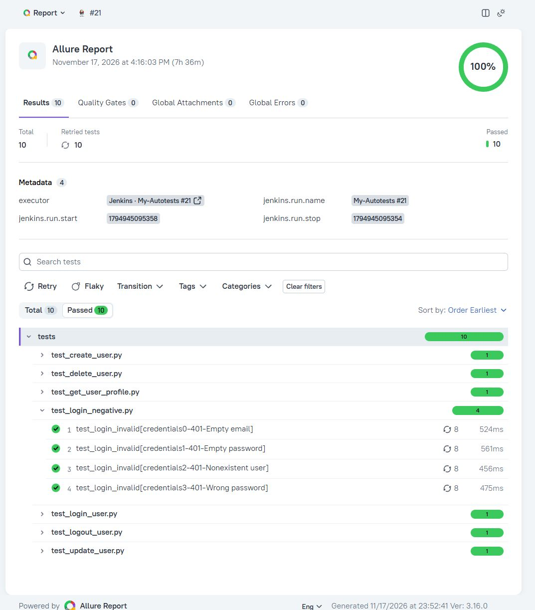

# Фреймворк для тестирования API Contact List App 

[English](./README.md) | **Русский**

[](https://www.python.org/)
[](https://pytest.org/)
[](https://allurereport.org/)


## 📖 Документация API

- [Postman Collection — Contact List App](https://documenter.getpostman.com/view/4012288/TzK2bEa8)

## ✅ Список проверок

- Создание пользователя
- Получение информации о пользователе
- Удаление пользователя

## 🛠 Стек технологий

| Технология | Назначение |
| :--- | :--- |
| **Python 3.14** | Язык программирования |
| **pytest** | Фреймворк для тестирования |
| **requests** | HTTP-клиент для API-запросов |
| **Allure** | Генерация отчётов |

## 🚀 Установка и запуск

### 💻 1. Клонировать репозиторий
#### - Ввести свой вариант пароля вместо "password" (optional)

```bash
git clone https://github.com/zhrv80-prog/PythonProject.git
cd Portfolio_project_tests
MY_APP_PASSWORD="password" pytest
```
## Allure отчет



## Jenkins

Проект интегрирован с Jenkins. 
Пайплайн автоматически запускает тесты при пуше в репозиторий. Конфигурация пайплайна находится в файле Jenkinsfile



## Allure отчет в Jenkins 

